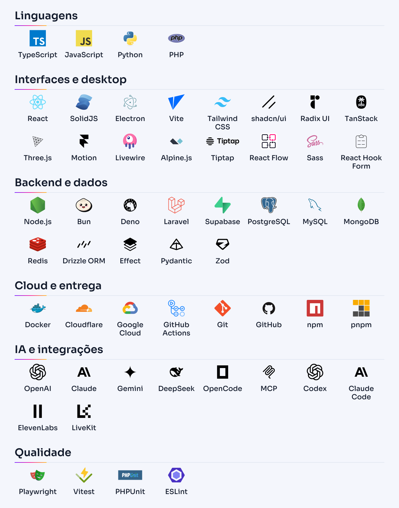
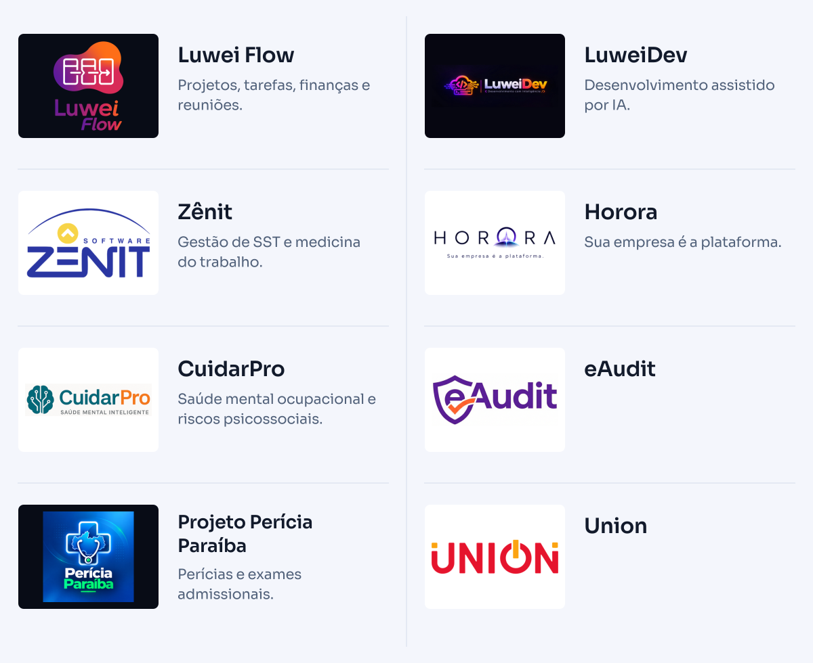

<picture>
  <source media="(max-width: 767px) and (prefers-color-scheme: dark)" srcset="./assets/hero-mobile-dark.svg">
  <source media="(max-width: 767px)" srcset="./assets/hero-mobile-light.svg">
  <source media="(prefers-color-scheme: dark)" srcset="./assets/hero-dark.svg">
  
</picture>

  <a href="#stack-de-engenharia">Stack</a> &nbsp;·&nbsp;
  <a href="#projetos">Projetos</a> &nbsp;·&nbsp;
  <a href="#como-penso">Como penso</a> &nbsp;·&nbsp;
  <a href="https://luwei.com.br/">Conheça a Luwei ↗</a>

Sou **Lucas Sousa**, Engenheiro de Software e fundador da **[Luwei Software House](https://github.com/Luwei-Soft-House)**. Desenho e desenvolvo produtos digitais, automação e inteligência artificial para transformar operações complexas em experiências claras, úteis e humanas.

## Stack de engenharia

As tecnologias que uso para construir interfaces, serviços, integrações e produtos com IA.

<picture>
  <source media="(max-width: 767px) and (prefers-color-scheme: dark)" srcset="./assets/stack-mobile-dark.svg">
  <source media="(max-width: 767px)" srcset="./assets/stack-mobile-light.svg">
  <source media="(prefers-color-scheme: dark)" srcset="./assets/stack-dark.svg">
  
</picture>

  
<strong>Ver a stack completa em texto</strong>

| Área | Tecnologias |
| :--- | :--- |
| **Linguagens** | TypeScript · JavaScript · Python · PHP |
| **Interfaces e desktop** | React · SolidJS · Electron · Vite · Tailwind CSS · shadcn/ui · Radix UI · TanStack · Three.js · Motion · Livewire · Alpine.js · Tiptap · React Flow · Sass · React Hook Form |
| **Backend e dados** | Node.js · Bun · Deno · Laravel · Supabase · PostgreSQL · MySQL · MongoDB · Redis · Drizzle ORM · Effect · Pydantic · Zod |
| **Cloud e entrega** | Docker · Cloudflare · Google Cloud · GitHub Actions · Git · GitHub · npm · pnpm |
| **IA e integrações** | OpenAI · Claude · Gemini · DeepSeek · OpenCode · MCP · Codex · Claude Code · ElevenLabs · LiveKit |
| **Qualidade** | Playwright · Vitest · PHPUnit · ESLint |

## Projetos

Produtos e plataformas do ecossistema Luwei.

<picture>
  <source media="(max-width: 767px) and (prefers-color-scheme: dark)" srcset="./assets/projects-mobile-dark.svg">
  <source media="(max-width: 767px)" srcset="./assets/projects-mobile-light.svg">
  <source media="(prefers-color-scheme: dark)" srcset="./assets/projects-dark.svg">
  
</picture>

**Explorar:** [Luwei Flow ↗](https://luweiflow.com.br/) · [LuweiDev ↗](https://luweidev.com.br/) · [Zênit ↗](https://softzenit.com.br/) · [CuidarPro ↗](https://cuidarpro.com.br/) · [Perícia Paraíba ↗](https://periciaparaiba.com.br/)

  
<strong>Ver o diretório de projetos em texto</strong>

| Projeto | Propósito |
| :--- | :--- |
| **[Luwei Flow](https://luweiflow.com.br/)** | Projetos, tarefas, finanças e reuniões. |
| **[LuweiDev](https://luweidev.com.br/)** | Desenvolvimento assistido por IA. |
| **[Zênit](https://softzenit.com.br/)** | Gestão de SST e medicina do trabalho. |
| **Horora** | “Sua empresa é a plataforma.” |
| **[CuidarPro](https://cuidarpro.com.br/)** | Saúde mental ocupacional e riscos psicossociais. |
| **eAudit** | — |
| **[Projeto Perícia Paraíba](https://periciaparaiba.com.br/)** | Agendamento de perícias e exames admissionais. |
| **Union** | — |

## Como penso

**Clareza antes da complexidade.** O problema precisa fazer sentido antes da solução.

**Tecnologia a serviço das pessoas.** A experiência faz parte da engenharia.

**Construção contínua, com intenção.** Cada entrega abre espaço para o próximo passo.

---

  <strong>Think boldly. Build simply. Move forward.</strong> 
  <a href="https://luwei.com.br/">Luwei Software House</a> &nbsp;·&nbsp;
  <a href="https://github.com/Luwei-Soft-House">Nosso GitHub ↗</a>

