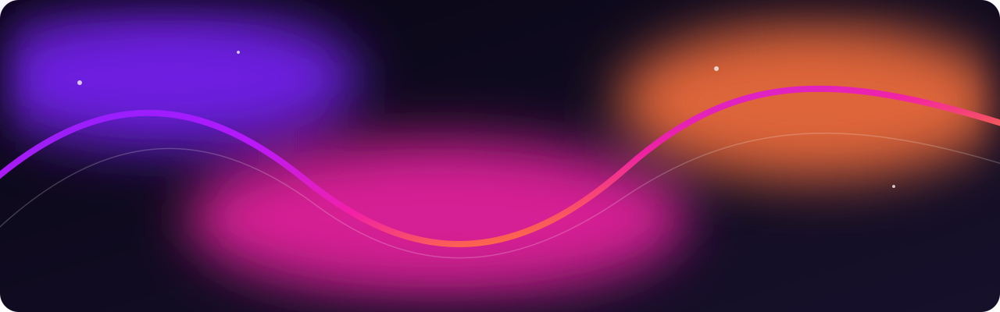

  

  

<h1 align="center">Lucas Sousa</h1>

  Engenheiro de Software · Fundador da <a href="https://github.com/Luwei-Soft-House">Luwei Software House</a>

  <a href="https://luwei.com.br">Luwei</a> · <a href="https://luweiflow.com.br">Luwei Flow</a> · <a href="https://luweidev.com.br">Luwei Dev</a>

## Construo o próximo.

Desenho e desenvolvo produtos digitais, automação e inteligência artificial para transformar operações complexas em experiências claras, úteis e humanas.

## Como penso

- Clareza antes da complexidade.
- Tecnologia a serviço das pessoas.
- Construção contínua, com intenção.

> Think boldly. Build simply. Move forward.
