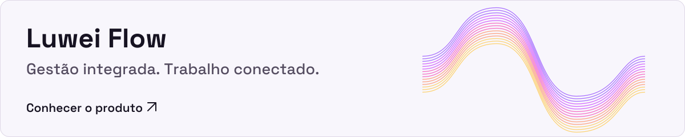
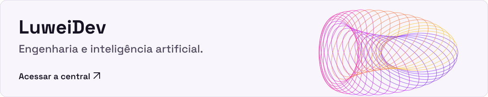
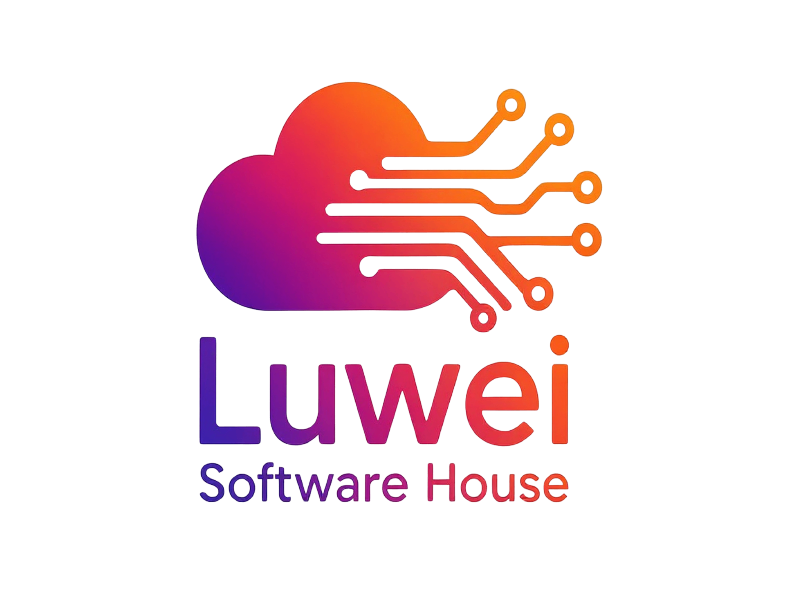

<picture>
  <source media="(max-width: 767px) and (prefers-color-scheme: dark)" srcset="./assets/hero-mobile-dark.svg">
  <source media="(max-width: 767px)" srcset="./assets/hero-mobile-light.svg">
  <source media="(prefers-color-scheme: dark)" srcset="./assets/hero-dark.svg">
  
</picture>

  <a href="#ecossistema">Ecossistema</a> &nbsp;·&nbsp;
  <a href="#tecnologia-com-propósito">Tecnologia</a> &nbsp;·&nbsp;
  <a href="#como-penso">Como penso</a> &nbsp;·&nbsp;
  <a href="https://luwei.com.br/">Conheça a Luwei ↗</a>

## Software com intenção.

Sou **Lucas Sousa**, Engenheiro de Software e fundador da **[Luwei Software House](https://github.com/Luwei-Soft-House)**.

Desenho e desenvolvo produtos digitais, automação e inteligência artificial para transformar operações complexas em experiências claras, úteis e humanas.

## Ecossistema

Produto, engenharia e inteligência conectados por um propósito: ampliar o que pessoas e empresas podem realizar.

<a href="https://luweiflow.com.br/">
  <picture>
    <source media="(max-width: 767px) and (prefers-color-scheme: dark)" srcset="./assets/flow-mobile-dark.svg">
    <source media="(max-width: 767px)" srcset="./assets/flow-mobile-light.svg">
    <source media="(prefers-color-scheme: dark)" srcset="./assets/flow-dark.svg">
    
  </picture>
</a>

**[Luwei Flow](https://luweiflow.com.br/)** conecta projetos, tarefas, finanças e reuniões em uma plataforma de gestão.

<a href="https://luweidev.com.br/">
  <picture>
    <source media="(max-width: 767px) and (prefers-color-scheme: dark)" srcset="./assets/dev-mobile-dark.svg">
    <source media="(max-width: 767px)" srcset="./assets/dev-mobile-light.svg">
    <source media="(prefers-color-scheme: dark)" srcset="./assets/dev-dark.svg">
    
  </picture>
</a>

**[LuweiDev](https://luweidev.com.br/)** é a central da Luwei Software House para desenvolvimento assistido por inteligência artificial.

## Tecnologia com propósito

As ferramentas mudam. O cuidado com o produto permanece.

  
<strong>Tecnologias no ecossistema Luwei</strong>

| Área | Ferramentas e práticas |
| :--- | :--- |
| **Interfaces e produto** | React · Next.js · TypeScript |
| **Serviços e dados** | Node.js · Python · PostgreSQL · MongoDB |
| **Infraestrutura e entrega** | Docker · Kubernetes · CI/CD |
| **Inteligência e automação** | Inteligência artificial · Machine learning |
| **Forma de trabalhar** | Scrum · Kanban · Testes · DevSecOps |

Seleção das tecnologias e práticas apresentadas no [site institucional da Luwei](https://luwei.com.br/).

## Como penso

**Clareza antes da complexidade.**
O problema precisa fazer sentido antes da solução.

**Tecnologia a serviço das pessoas.**
A experiência faz parte da engenharia.

**Construção contínua, com intenção.**
Cada entrega abre espaço para o próximo passo.

---

  

  <strong>Think boldly. Build simply. Move forward.</strong> 
  <a href="https://luwei.com.br/">Luwei Software House</a> &nbsp;·&nbsp;
  <a href="https://github.com/Luwei-Soft-House">Nosso GitHub ↗</a>

